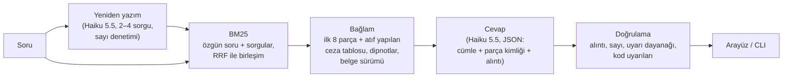

# mevzuat-rag

Türk tüketici ve e-ticaret mevzuatı hakkındaki soruları **kaynak göstererek** cevaplayan bir RAG aracı.
Cevaptaki her cümle, mevzuattan kelimesi kelimesine bir alıntıya dayanır. Alıntı kaynakta
bulunamazsa cümle kullanıcıya gösterilmez. Cevap belgelerde yoksa araç bunu açıkça söyler; genel
bilgiyle boşluk doldurmaz.

- **Canlı demo:** https://mevzuat-rag.streamlit.app (kendi Anthropic API anahtarınızla çalışır;
  örnek sorular anahtarsız görüntülenebilir)
- **Arayüz:** `streamlit run streamlit_app.py` (Streamlit)
- **Komut satırı:** `python ask.py "soru"`
- **Hukuki tavsiye değildir.** Araç mevzuatın ne dediğini aktarır, somut olay hakkında görüş bildirmez.

## Kapsam

| Dosya (`docs_raw/`) | Belge |
|---|---|
| `1.5.6502.pdf` | 6502 sayılı Tüketicinin Korunması Hakkında Kanun (TKHK) |
| `1.5.6563.pdf` | 6563 sayılı Elektronik Ticaretin Düzenlenmesi Hakkında Kanun (ETK) |
| `1.5.6698.pdf` | 6698 sayılı Kişisel Verilerin Korunması Kanunu (KVKK) |
| `7.5.20237.pdf` | Mesafeli Sözleşmeler Yönetmeliği (MSY) |

PDF'ler depoda yer alır. Bunlar resmî mevzuat metinleridir; kaynak mevzuat.gov.tr, **indirme
tarihi 2026-11-23**. Bu tarihten sonraki değişiklikler kapsanmaz. `docs_raw/` içindeki dosyalar
değiştirilmez. Bu metinler kodun MIT lisansı kapsamında değildir (bkz. [Lisans](#lisans)).

## Mimari



```
soru → yeniden yazım → BM25 (+RRF) → bağlam → cevap (model) → doğrulama → kullanıcı
```

| Adım | Modül | Not |
|---|---|---|
| Parçalama | `scripts/build_chunks.py`, `chunk.py`, `extract.py` | Madde bazlı; uzun maddeler fıkra/bent sınırından bölünür. Dipnotlar punto farkıyla ayrılır. Çıktı `data/chunks.jsonl` depoda. |
| Yeniden yazım | `rewrite.py` | Soru 2–4 mevzuat dili sorguya çevrilir. Soruda olmayan sayı içeren sorgu kodla atılır. Çağrı başarısız olursa düz BM25'e düşülür ve uyarı gösterilir. |
| Arama | `retrieve.py`, `textnorm.py` | BM25, Türkçe küçük harf + F5 kırpma, madde numarası belirteçleri (`md:tkhk:48`). Özgün soru ve sorgular RRF (k=60) ile birleşir. torch gerekmez. |
| Bağlam | `context.py` | İlk 8 parça. Bir parçanın dipnotu ceza tablosuna atıf yapıyorsa tablo eklenir; tablo bağlamdaysa bağlı madde parçaları (en fazla 3) eklenir. Dipnotlar tekilleştirilir. Yeniden yazılmış sorgular modele verilmez. |
| Cevap | `answer.py` | JSON şeması: durum, cümleler (her biri parça kimliği + alıntı), bulunamayan kısımlar, uyarılar. |
| Doğrulama | `verify.py`, `answer.py` | Aşağıda. |
| Arayüz | `streamlit_app.py`, `arayuz.py` | Arayüz mantığı (atıf, sayaç, istemci) Streamlit'ten ayrı ve test edilir. |

Veritabanı yok: ~200 parça bellekte BM25 ile aranır.

## Doğrulama katmanları

Modelin çıktısına güvenilmez; kullanıcıya giden her şey kodla denetlenir.

1. **Alıntı denetimi.** Her cümlenin dayanağındaki alıntı (3–40 kelime), gösterilen parçada aranır.
   Boşluk, tire, tırnak ve büyük/küçük harf farkları normalize edilir. Bağlamda olmayan parça
   kimliği (uydurma kimlik) doğrulanamaz ve ayrıca sayılır.
2. **Sayı tutarlılığı.** Cümledeki süre, tutar, oran, tarih ve madde numaraları alıntıda ya da
   parçada birimiyle birlikte geçmeli. Rakam ve yazı eşlenir ("14 gün" = "on dört gün");
   "iki yıl" bir fıkra numarası "(2)" ile eşleşmez.
3. **Doğrulanamayan cümle gösterilmez.** Cevabın üstüne "N cümle kaynağında doğrulanamadığı için
   çıkarıldı" notu konur ve durum en fazla "kısmen cevaplandı" olur. Hepsi çıkarsa
   "belgelerde bulunamadı" olur.
4. **Model uyarıları da doğrulanır.** Modelin uyarıları da dayanak ve alıntı taşımak zorundadır.
   Doğrulanamayan uyarı gösterilmez.
5. **Kod uyarıları (modelden bağımsız):**
   - Anayasa Mahkemesi iptal dipnotu.
   - Mülga hüküm. Bağlamın ilk 3 parçasındaysa ya da madde numarası soruda geçiyorsa, cümleler
     doğrulanamasa bile gösterilir.
   - Yıllık güncellenen tutar ("madde metnindeki tutar eski, güncel tutar tabloda").
   - Ceza tablosundaki belirsizlik.
   - Aramanın düz BM25'e düşmesi.
6. **Okunamayan çıktı.** Model JSON'u okunamazsa bir kez yeniden denenir. Yine olmazsa "sistem
   hatası" gösterilir; bu "belgelerde yok" ile karıştırılmaz.
7. **Prompt kuralları** (kodla değil, modelle):
   - Sorudaki gömülü talimatlar uygulanmaz.
   - Hüküm kurulmaz, tavsiye verilmez.
   - Sayılan haklar ve koşullar eksiltilmez; eksiltilirse kısmi olduğu belirtilir.
   - Ceza tablosu tek başına kullanılmaz.

## Değerlendirme sonuçları

İki geliştirme seti ve ayrı bir holdout seti var. Bütün kararlar
(kabul kuralları, gürültü payı) ölçümden **önce** [docs/kararlar.md](docs/kararlar.md)'ye kaydedildi.
Yeniden yazım koşudan koşuya değiştiği için her ölçüm 3 koşu yapıldı. Tablolarda en düşük / medyan /
en yüksek değer var.

| Set | Rol | Soru |
|---|---|---|
| `evals/retrieval.yaml` (dev1) | Arama seçenekleri bu sette seçildi | 26 cevaplı + 4 cevapsız |
| `evals/answers.yaml` (dev2) | Cevap üretimi ve teşhis; sonradan yazıldı, daha zor | 15 cevaplı + 5 cevapsız |
| `evals/holdout.yaml` | Son doğrulama; sistem dondurulduktan sonra **bir kez** koşuldu (etiket `sistem-donduruldu-holdout`) | 17 cevaplı + 3 cevapsız |

Holdout soruları proje sahibi yerine sohbetteki Claude tarafından yazıldı; yazan geliştirme
setlerini görmüştü. Holdout bu yüzden tam bağımsız değil (sınır dosyanın başında yazılı).

**Arama** (varsayılan hat, 3 koşu; @k = doğru madde ilk k sonuçta; bağlam = modele giden k=8 parça
ve eklemeler; [evals/HOLDOUT_RAPOR.md](evals/HOLDOUT_RAPOR.md)):

| | dev1 (26) | dev2 (15) | **holdout (17)** |
|---|---|---|---|
| @1 | 15 / 15 / 17 (%58) | — | 7 / 8 / 10 (%47) |
| @3 | 19 / 22 / 22 (%85) | — | 10 / 11 / 12 (%65) |
| @5 | 23 / 23 / 24 (%88) | — | 12 / 13 / 13 (%76) |
| Bağlam, k=8 | 24 / 24 / 25 (%92) | 12 / 12 / 13 (%80) | **12 / 13 / 14 (%76)** |

**İki set arasındaki fark büyük ve önemli.** dev1, arama seçeneklerinin seçildiği set; bu yüzden
iyimser. dev2'de varsayılan hat düz BM25'ten bile biraz kötü (bağlam 12'ye 13). Kalan hataların
çoğu yeniden yazımın soruyu yanlış hukuki kavrama çevirmesinden ve benzer maddelerin kalabalık
etmesinden geliyor ([evals/ARAMA_TESHIS.md](evals/ARAMA_TESHIS.md)). Bu hataları hedefleyen üç
değişiklik ölçüldü; hiçbiri önceden konan +3 eşiğini geçmedi ([evals/ARAMA_DENEYI.md](evals/ARAMA_DENEYI.md)).
**Holdout dev2 tarafında çıktı:** bağlam düzeyinde %76. Gerçekçi beklenti dev1'in %92'si değil,
%75–80. Holdout'ta her koşuda kaçan sorular: H10 (KVKK m.8), H13 (MSY m.15), H15'in ikinci yarısı
(TKHK m.45).

Atıf takibi (bir maddenin numarayla atıf yaptığı maddeyi bağlama eklemek) de ölçüldü; bağlam
kazancı +1 ile eşiğin (+2) altında kaldı ve reddedildi ([evals/ATIF_DENEYI.md](evals/ATIF_DENEYI.md)).

**Cevap üretimi, model seçimi** (dev2, Haiku ve Sonnet, 3 koşu; [evals/CEVAP_RAPOR.md](evals/CEVAP_RAPOR.md)):

| Ölçüt | Haiku 5.5 (seçilen) | Sonnet 5.5 |
|---|---|---|
| Yanlış olgu (elle okuma, 3 koşuda 45 cevap) | **0** | 0 |
| Madde doğruluğu (cevaplı 15) | 9 / 10 / 11 (%60–73) | 10 / 11 / 12 |
| Yanlış reddetme (cevaplı 15) | 2 / 3 / 3 (%13–20) | 1 / 2 / 2 |
| Olgu oranı | %58 / 67 / 75 | %67 / 71 / 71 |
| Doğru reddetme (cevapsız 5) | 5 / 5 / 5 | 5 / 5 / 5 |
| Gömülü talimatı uyguladı | 0 | 0 |
| Liste eksik aktarılmış (elle) | 2 / 45 | 0 / 45 |
| Maliyet / cevap (arama dahil) | ~$0,002 | ~$0,03 |
| Süre / cevap | ~2,6 sn | ~4,2 sn |

**Cevap üretimi, holdout** (Haiku 5.5, tek koşu). dev2 sütunu aynı sistemin 3 koşusu.

| Ölçüt | dev2 (15 + 5) | holdout (17 + 3) |
|---|---|---|
| Cevaplandı / kısmen / bulunamadı (cevaplı sorularda) | 8–9 / 3–4 / 2–3 | 10 / 7 / 0 |
| Alıntı doğrulama oranı | %95–98 | %98 |
| Çıkarılan cümle | 1–2 | 1 (46 cümlede) |
| Cevapsız soruda reddetme | 5 / 5 | 3 / 3 |

**Holdout elle okuma** (20 cevabı sohbetteki Claude okudu; [evals/HOLDOUT_RAPOR.md](evals/HOLDOUT_RAPOR.md), bölüm 4):

| Ölçüt | Sonuç |
|---|---|
| Beklenen bilgi doğru verildi (cevaplı 17) | **14 / 17** |
| Yanlış sayı, süre ya da tutar | 0 |
| Cevapsız soruda reddetme | 3 / 3 |
| Yanlış rejimin hükmünü uygulama | 1 (H07) |
| Somut olaya yorum | 1 (H09) |

- **H07:** Devre tatil sorusuna Mesafeli Sözleşmeler Yönetmeliği m.10 uygulandı. Alıntı doğru
  olduğu için doğrulamadan geçti; mevcut denetimler bu hatayı yakalamıyor.
- **H09:** Somut olaya yorum yapıldı ("istisna kapsamında değerlendirilebilir"). Ayrıca holdout
  notunda soru yazarının bir hatası vardı: "aynı konutta yaşayan" kaydı atlanmıştı.
- **H13:** İstisna maddesi (MSY m.15) bağlama gelmedi. Cevap genel cayma kuralını verdi; istisnanın
  bulunamadığını yalnız altta belirtti. Cümleler doğru, ama okuyanı yanlış sonuca götürebilir.
- **H10, H15:** Beklenen madde bağlamda yoktu; model eksiği açıkça belirtti.

Zayıf yanlar:

- **Madde doğruluğu %60–73.** Soruların yaklaşık üçte birinde cevap ya eksik ya da hiç yok.
- **Yanlış reddetme %13–20.** Cevabı belgelerde olan bazı sorulara "bulunamadı" deniyor. Nedenleri:
  - Gerekli madde bağlama gelmiyor (A10, A11).
  - Cevap bir atıf zincirinin bütün halkalarını gerektiriyor (A15: m.47/2 → m.77/5 → tablo;
    [evals/A15_teshis.md](evals/A15_teshis.md)).
  - Doğrulayıcı alıntısı birebir olmayan cümleleri eliyor.

  Araç yanlış bilgi vermek yerine susmayı seçiyor; bu tasarım gereği, ama bedeli kaçırılan cevaplar.
- **Sonnet bu iki ölçütte biraz daha iyi.** Seçim yanlış olgu sayısına göre yapıldı; Sonnet ancak
  en az 2 daha az yanlış olguyla seçilecekti, iki modelde de 0. Sonnet cevap başına ~18 kat pahalı.
- **Liste bütünlüğü kuralı yeni.** Bu kural eklenmeden önceki 120 cevapta 2 eksik liste bulundu.
  Kuralın etkisi henüz ölçülmedi.
- **Örneklem küçük.** dev2'de bir soru ~%7, holdout'ta ~%6 puan; koşular arası oynama 1–2 soru.
- **Holdout'ta arama %76.** Kaçırılan maddeler gerçek kullanımda da kaçırılacak; araç bu durumda ya
  susar ya da başka maddelerle kısmi cevap verir.

## Arayüz ve yayın

```powershell
.venv\Scripts\streamlit run streamlit_app.py
```

- Örnek sorular, kaynaklı cümleler ("6502 m.24/1"; tıklanınca kelimesi kelimesine alıntı ve
  maddenin tam metni) gösterilir.
- "Belgelerde bulunamadı" ve "kısmen cevaplandı" ayrı gösterilir; bulunamayan kısım yazılır.
- İptal kararı ve mülga uyarıları kırmızı ve en üstte. Altta kapsanan belgeler, indirme tarihi ve
  "hukuki tavsiye değildir" notu var.
- Yan paneldeki "Arama ayrıntıları" yeniden yazılan sorguları ve bağlama giren parçaları gösterir.

**Yayındaki demo ziyaretçinin kendi anahtarıyla çalışır.** Ortak anahtar bilerek tanımlı değil.

- **Anahtar olmadan:**
  - Sayfanın üstünde sakin bir bilgi notu görünür: "Bu demo kendi Anthropic API anahtarınızla
    çalışır; örnek sorular anahtarsız görüntülenebilir".
  - Beş örnek sorunun her biri **kayıtlı cevabı** gösterir. Kayıt `data/ornek_cevaplar.json`
    dosyasında: cevap nesnesinin tamamı, yani cümleler, alıntılar, uyarılar, kaynaklar ve arama
    ayrıntıları, üretim tarihi ve modelle birlikte.
  - Kayıtlı cevabın üstünde "Kayıtlı örnek cevap (üretim tarihi …); kendi sorunuzu sormak için yan
    panelden API anahtarınızı girin" notu yer alır.
  - Kayıtlı cevap canlı cevapla aynı arayüz koduyla çizilir. Model çağrısı yapılmaz.
- **Ziyaretçi anahtarıyla:** yan paneldeki parola alanına girilen anahtar:
  - yalnız o oturumun istemcisine verilir;
  - süreç ortamına, ekrana ya da günlüğe yazılmaz;
  - ortak günlük sınırdan düşmez.

  Serbest sorular ve örnek sorular canlı cevaplanır.
- **Hata mesajları:**
  - "Anahtar geçersiz" yalnız ziyaretçinin kendi girdiği anahtar reddedildiğinde çıkar.
  - Ortak anahtar tanımlıysa ama reddedilirse ziyaretçiye hata gösterilmez. Ortak anahtar sunucu
    yeniden başlayana kadar kullanılmaz ve demo anahtarsız durumdaki gibi davranır.
  - Bağlantı sorunlarında "Servise ulaşılamadı" görünür.
  - API'nin ham hata metni hiç gösterilmez.
- Soru en fazla 500 karakter.
- Kayıtlı cevapları yeniden üretmek için (yerelde, `.env` anahtarıyla):
  `python scripts/ornek_cevaplari_uret.py`.

**Ortak anahtar ve günlük sınır (isteğe bağlı):**

- **Ortak anahtar** `st.secrets["ANTHROPIC_API_KEY"]`'den, yoksa ortam değişkeninden ya da `.env`'den
  okunur. `.env` ve `.streamlit/secrets.toml` git'e girmez.
- **Günlük çağrı sınırı:** ortak anahtarla yapılan her model çağrısı sayılır: yeniden yazım, cevap ve
  JSON okunamazsa yapılan ikinci deneme.
  - Varsayılan sınır 300; `GUNLUK_CAGRI_SINIRI` (secrets ya da ortam) ile değişir.
  - Soru başına normalde 2 çağrı gider. Kalan hak 2'nin altına düşünce soru çalıştırılmaz.
  - **Kimlik doğrulama ve bağlantı hatalarıyla (zaman aşımı dahil) biten çağrılar sayılmaz;**
    diğer API hataları sayılır. SDK'nın ağ hatalarında yaptığı otomatik yeniden denemeler tek çağrı
    sayılır.
- **Sayaç bellekte tutulur.**
  - Sunucu süreci yeniden başlarsa sıfırlanır.
  - Birden çok süreç ya da kopya çalışıyorsa her biri kendi sayacını tutar, yani gerçek üst sınır
    kopya sayısıyla çarpılır.
  - Sayaç UTC gününe göre sıfırlanır.
  - Kalıcı ve paylaşılan bir sınır gerekiyorsa API sağlayıcısının harcama sınırı da ayarlanmalı.

**Streamlit Community Cloud'da yayın** (yayındaki adres: https://mevzuat-rag.streamlit.app):

1. Depoyu bağla. Ana dosya `streamlit_app.py`, bağımlılık dosyası `requirements.txt`.
2. Secrets gerekmez: demo ziyaretçi anahtarıyla ve kayıtlı örnek cevaplarla çalışır.
3. İstenirse ortak anahtar açılabilir. Bunun için App settings → Secrets bölümüne şunlar girilir (TOML):

   ```toml
   ANTHROPIC_API_KEY = "sk-ant-..."
   GUNLUK_CAGRI_SINIRI = "200"
   ```

   - Önerilen sınır 200 çağrı, yani günde yaklaşık 100 soru (her soru 2 çağrı).
   - Haiku 5.5 ile soru başına yaklaşık $0,002 tutar: günde yaklaşık $0,20, ayda yaklaşık $6.
   - Sayaç uygulama yeniden başlayınca sıfırlandığı için Anthropic Console'da aylık harcama sınırı
     da ayarlanmalı (ör. $10).

**Yayın ortamı yalnızca `requirements.txt` ile çalışır.** Bu dosyada torch, sentence-transformers
ve pymupdf yok; hazır `data/chunks.jsonl` kullanılır. Temiz bir ortamda bu dosyayla bütün testler
geçer (PDF işleme ve embedding testleri atlanır).

## Kurulum

| Dosya | Ne için | Yayında |
|---|---|---|
| `requirements.txt` | Arama, cevap, arayüz, testler | ✔ |
| `requirements-build.txt` | PDF'lerden `chunks.jsonl` üretmek (`pymupdf`) | ✘ |
| `requirements-embedding.txt` | Embedding modları, deneyler (torch) | ✘ |

```powershell
python -m venv .venv
.venv\Scripts\python -m pip install -r requirements.txt
.venv\Scripts\python -m pip install -e .
.venv\Scripts\python -m pytest
```

Yerelde anahtar için proje kökünde `.env`: `ANTHROPIC_API_KEY=...`.

## Komut satırı

```powershell
.venv\Scripts\python ask.py "Bankadan çektiğim krediden vazgeçtim, kaç gün içinde cayabilirim?"
.venv\Scripts\python ask.py "..." --json                  # bütün alanlar (çıkarılan cümleler dahil)
.venv\Scripts\python search.py "aldığım ürünü beğenmedim geri verebilir miyim"
.venv\Scripts\python search.py "6502 m.48" --yeniden-yazma -k 3          # model çağrısı yok
.venv\Scripts\python scripts\build_chunks.py                             # requirements-build.txt
.venv\Scripts\python scripts\eval_answers.py --runs 3                    # cevap ölçümü (ücretli)
.venv\Scripts\python scripts\eval_retrieval.py --varsayilan --runs 3     # arama ölçümü (ücretli)
```

İsteğe bağlı embedding araması: `scripts\build_index.py --model bge-m3`, sonra
`search.py "..." --mode hybrid --model bge-m3`. Ölçümler: [evals/DENEYLER.md](evals/DENEYLER.md).

## Bilinen sınırlar

- **Yanlış rejimin hükmü uygulanabilir.** Alıntı kaynakta birebir geçse de alıntının alındığı madde
  sorunun konusuyla ilgili olmayabilir. Örnek: devre tatil sorusuna (TKHK m.50) mesafeli sözleşme
  kuralı (MSY m.10) uygulandı (holdout H07). Alıntı, sayı ve uyarı denetimleri bunu yakalamaz.
- **"Kısmen cevaplandı" durumunda eksik kısım yeterince belirgin değil.** Bulunamayan kısım
  gösteriliyor, ama genel kural cevap olarak verilip istisna "bulunamadı" diye kenarda kalınca
  cevap okuyanı yanlış sonuca götürebilir (holdout H13: kişiye özel ürünlerde cayma istisnası).
- **Arama, görülmemiş sorularda yaklaşık dörtte bir oranında doğru maddeyi bağlama getiremiyor**
  (holdout bağlam düzeyi %76). Özellikle zor olanlar:
  - istisna maddeleri (H13, MSY m.15);
  - numarayla yapılan atıflar (A15: m.77/5 → m.47/2).
- **Holdout sorularını kullanıcı değil bir yapay zeka yazdı** (sohbetteki Claude). Yazan geliştirme
  setlerini görmüştü; holdout bu yüzden tam bağımsız değil ve kullanıcıların gerçek sorularını
  temsil etmeyebilir.
- **Kavram çevirme.** Günlük dildeki soru bazen yanlış hukuki kavrama çevriliyor. Örnekler:
  - "pazaryeri ödemesi" sorusu, ETK ek m.1 yerine başka hükümlere gidiyor.
  - "kapıdan satış yetkisi" sorusu, "iş yeri dışında kurulan sözleşme" terimiyle eşleşmiyor.

  Bu durumda gerekli madde bağlama gelmez ve cevap "bulunamadı" olur.
- **Atıf zincirleri.** Bir madde başka bir maddeye yalnız numarasıyla atıf yapıyorsa (m.77/5 → "47
  nci maddenin ikinci fıkrası"), atıf yapılan madde bağlama otomatik eklenmez. Yalnız ceza
  tablosu atıfları izlenir.
- **Yanlış reddetme yanlış olguya tercih edildi.** Doğrulayıcı, alıntısı birebir olmayan doğru
  cümleleri de eler. Cevap kısalabilir ya da "bulunamadı"ya düşebilir.
- **Ceza tablolarında belirsizlik.** 6502 m.77 ve 6563 m.12 tablolarının bazı satırlarında aynı
  fıkra için birden çok tutar var. Hangisinin geçerli olduğu tabloda yazmaz; araç tutarları sıralar
  ve bunu belirtir.
- **Yeniden yazım koşudan koşuya değişir.** Aynı soru farklı bağlam ve cevap üretebilir. Tek
  koşuluk sonuçlar (holdout dahil) bu oynama payıyla okunmalı.
- **API'ye bağımlılık.** Yeniden yazım çağrısı başarısız olursa düz BM25'e düşülür; düz BM25 günlük
  dil sorularında belirgin biçimde zayıftır (dev1'de günlük dil 3/8). Cevap çağrısı başarısız olursa
  cevap üretilmez.
- **Ayrıştırma bu dört PDF'in biçimine göre ayarlandı.** Yeni belge eklenirse
  `reports/dogrulama.md` yeniden incelenmeli.
- **Dışarıda bırakılanlar.** Bunlar indekste yok:
  - kanunların sonundaki değişiklik ve yürürlük listeleri;
  - KVKK kadro cetveli;
  - yönetmeliğin Resmî Gazete listesi.

  Mülga maddeler kısa bir kayıt olarak (tarih ve dayanakla) indekste kalır.
- **Tarih kapsamı:** 2026-11-23 sonrası değişiklikler yok. AYM iptal kararlarının yürürlük tarihleri
  dipnotlardan gösterilir.
- **Günlük sınır bellekte** (bkz. Arayüz ve yayın).

## Sonraki sürüm

Uygulanmadı; holdout bulgularından çıkan iş listesi.

1. **Rejim denetimi.** Cümlenin dayandığı maddenin sorunun konusuyla ilgili olduğu denetlenmeli.
   Alıntı doğru olsa da madde sorunun konusuyla ilgili olmayabilir. Örnek: mesafeli sözleşme kuralı
   devre tatil sorusunda kullanıldı (H07).
2. **"Kısmen cevaplandı" görünürlüğü.** Bulunamayan kısım cevabın üstünde ve belirgin gösterilmeli.
   Özellikle bir istisna bulunamadıysa, genel kural okuyanı yanlış sonuca götürmemeli (H13).
3. **Arama kapsaması.** Görülmemiş sorularda doğru madde yaklaşık dörtte bir oranında bağlama
   gelmiyor. Öncelikli alanlar:
   - istisna maddeleri;
   - numarayla yapılan atıflar (bu sürümde ölçülen atıf takibi eşiği geçemedi).
4. **Gerçek holdout.** Yeni bir holdout seti kullanıcılar tarafından ya da geliştirme setlerini
   görmemiş biri tarafından yazılmalı. Bu sürümün holdout'unu bir yapay zeka yazdı.

## Lisans

Kod [MIT lisansı](LICENSE) ile dağıtılır (© 2026 Muhammed Ahmet Ertemiz).

`docs_raw/` içindeki PDF'ler ve onlardan türetilen `data/chunks.jsonl` resmî mevzuat metinleridir
(kaynak: mevzuat.gov.tr, indirme tarihi 2026-11-23). Bu metinler MIT lisansının kapsamında değildir.
